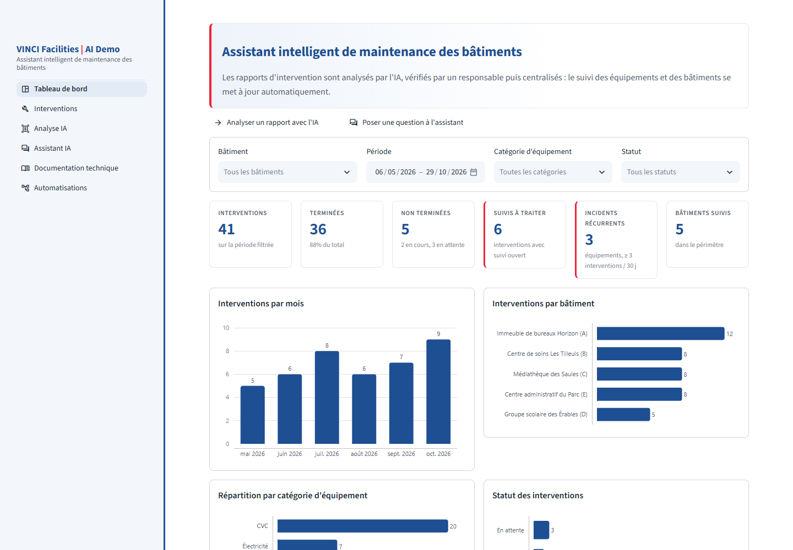
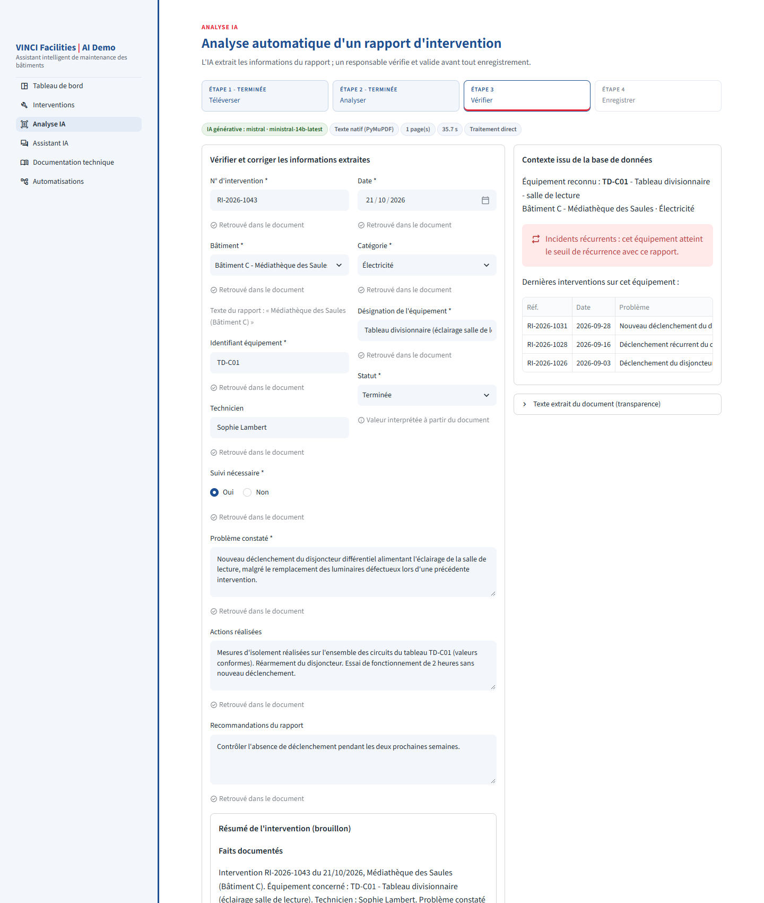
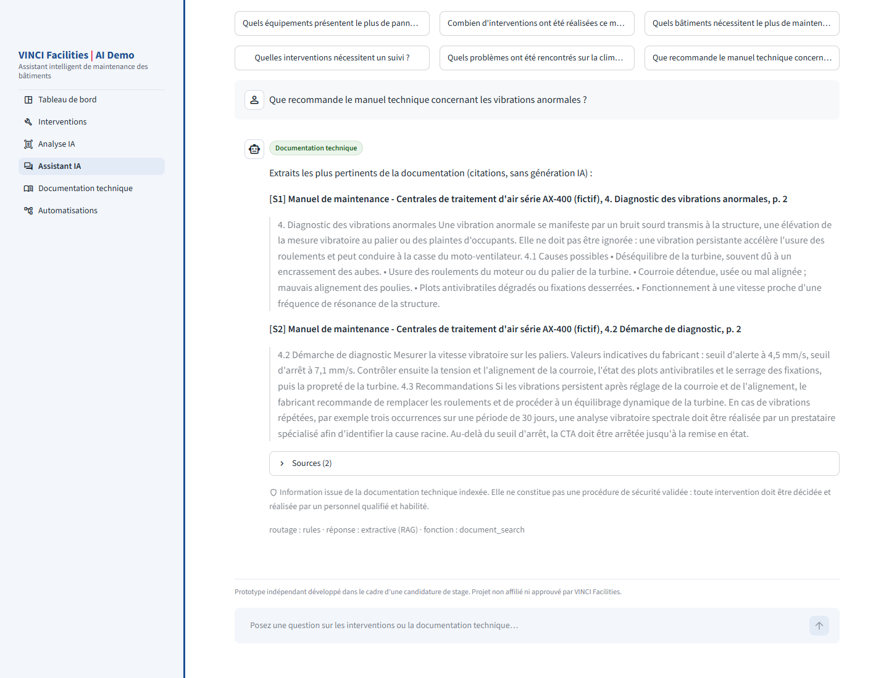

# VINCI Facilities AI Demo

Assistant intelligent de maintenance des bâtiments : analyse automatique des rapports d'intervention,
tableau de bord, assistant documentaire et automatisation des suivis.

> **Prototype indépendant** réalisé dans le cadre de ma candidature au stage Ingénieur IA & Data chez
> VINCI Facilities. Projet non affilié ni approuvé par VINCI Facilities. Toutes les données sont fictives.

## ▶️ Vidéo de démonstration

**Découvrez le prototype en fonctionnement :** cliquez sur le bouton ci-dessous ou sur la miniature pour regarder la vidéo sur YouTube.

[](https://www.youtube.com/watch?v=z9i72f1Dvo4)

[](https://www.youtube.com/watch?v=z9i72f1Dvo4)

*▶️ Cliquez sur l'image pour lancer la démonstration sur YouTube.*

## Pourquoi ce projet

J'ai réalisé ce projet de ma propre initiative, pour accompagner ma candidature au stage
**Ingénieur IA & Data** de VINCI Facilities Tertiaire Santé et Collectivités.

Plutôt que de simplement décrire mes compétences, j'ai voulu montrer concrètement ma motivation et ma
façon de travailler, en m'attaquant à une problématique proche des missions du poste : les rapports
d'intervention sont nombreux, hétérogènes et souvent ressaisis à la main. Ce prototype montre comment
l'IA et l'automatisation peuvent réduire ce travail répétitif tout en gardant l'humain dans la boucle.

## Fonctionnalités

- **Analyse IA des rapports** : téléversement d'un PDF (formulaire, compte rendu rédigé ou scan),
  extraction du texte (PyMuPDF, OCR Tesseract), extraction de 12 champs par un LLM (Mistral ou Gemini)
  avec validation Pydantic.
- **Vérification humaine** : rien n'est enregistré sans validation. Chaque champ indique s'il est
  retrouvé dans le document ; les informations absentes restent vides.
- **Tableau de bord** : indicateurs calculés depuis la base, filtres, détection des équipements à
  pannes récurrentes (3 interventions en 30 jours, paramétrable).
- **Assistant** : questions statistiques via des fonctions d'analyse prédéfinies (le LLM ne génère pas
  de SQL) et questions techniques via RAG (embeddings multilingues + ChromaDB), avec document et page cités.
- **Automatisation n8n** : e-mail au responsable lorsqu'un suivi est requis, uniquement après
  validation, sans doublon (idempotence).

## Aperçu

**Tableau de bord** : indicateurs et graphiques calculés à partir de la base.



**Analyse IA** : extraction d'un compte rendu rédigé par Mistral, vérification champ par champ et
alerte d'incidents récurrents.



**Assistant** : réponse issue des manuels techniques, avec document et page cités.



## Stack

Python · FastAPI · Streamlit · SQLite / SQLAlchemy · pandas · Plotly · PyMuPDF · Tesseract ·
Mistral / Gemini · Pydantic · Sentence Transformers · ChromaDB · n8n · pytest · Docker Compose

## Résultats

Mesurés sur le jeu de test fictif (10 rapports, 120 champs ; 12 questions documentaires) :

| Mesure | Résultat |
|---|---|
| Extraction, Gemini 2.5 Flash | 99,2 % des champs corrects, aucune valeur inventée |
| Extraction, Mistral (ministral-14b) | 98,3 % des champs corrects, 1 valeur inventée |
| Extraction, règles seules (référence) | 80,0 % (33 % sur les comptes rendus rédigés) |
| Recherche documentaire | bon document en 1re position 12/12, Recall@5 = 100 % |
| Questions hors documentation | 4/4 correctement refusées |
| Tests automatisés | 62 tests réussis |

Ces chiffres valident la démarche sur un petit jeu fictif ; ils ne préjugent pas des performances sur
des données réelles. Évaluations reproductibles : `scripts/evaluate_extraction.py` et
`scripts/evaluate_rag.py`.

## Lancer le projet

Avec Docker :

```bash
python scripts/bootstrap_env.py   # crée .env et génère les secrets
docker compose up --build
```

En local (Python 3.12+) :

```bash
python -m venv .venv
.venv\Scripts\activate            # Linux/macOS : source .venv/bin/activate
pip install -r requirements.txt
python scripts/bootstrap_env.py
python scripts/download_tessdata.py   # OCR français (facultatif)

uvicorn backend.main:app --host 0.0.0.0 --port 8000
streamlit run frontend/app.py
```

Interface : http://localhost:8501 · API : http://localhost:8000/docs

Sans clé API, l'application fonctionne en mode démo (extraction par règles, notifications simulées).
Les rapports PDF de test se trouvent dans `sample_data/reports/`.

## Configuration

Dans `.env` (voir `.env.example`) :

- **IA générative** : `DEMO_MODE=false`, puis `LLM_PROVIDER=mistral` avec `MISTRAL_API_KEY`, ou
  `LLM_PROVIDER=gemini` avec `GEMINI_API_KEY`.
- **n8n** (`docker compose --profile automation up -d n8n`, puis http://localhost:5678) :
  1. créer deux identifiants *Header Auth* (`X-Webhook-Secret` = `N8N_WEBHOOK_SECRET`,
     `X-N8N-Token` = `N8N_API_TOKEN`) et un identifiant SMTP ;
  2. importer `automation/n8n_workflow.json`, associer les identifiants, publier le workflow ;
  3. renseigner `N8N_PROCESSING_WEBHOOK_URL`, `N8N_FOLLOWUP_WEBHOOK_URL`, `N8N_CALLBACK_BASE_URL`
     et `NOTIFICATION_EMAIL`, puis redémarrer l'API.

## Structure

```text
backend/      API FastAPI : routes, services (PDF, IA, RAG, analytique, automatisation), modèles
frontend/     interface Streamlit
automation/   workflow n8n importable
sample_data/  données fictives : bâtiments, interventions, rapports PDF, manuels techniques
scripts/      génération des données, initialisation, évaluation
tests/        tests pytest
```

## Limites

Prototype de démonstration : données fictives, pas de gestion d'utilisateurs, SQLite mono-instance.
Les suggestions de l'IA restent une aide à la décision : toute intervention technique relève d'un
personnel qualifié.
